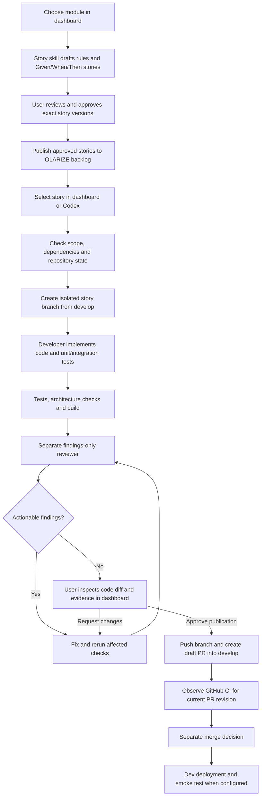

# Connected development workbench — agreed specification

Status: agreed target workflow, recorded 2026-09-24. A first connected local implementation now exists; live-provider validation remains pending. See README.md for verified behavior and current limitations. This document records the user's accepted requirements; implementation details labeled proposed remain to be validated.

## Purpose and boundary

Accelerate development of Olarize through a local dashboard that coordinates stories, code generation, verification, independent review and draft pull requests. This is developer tooling, not an HR feature, not the HR frontend, and not part of the production runtime. Keep its source in `developer-workbench/`, project instructions in `.instructions/`, skills in `.agents/skills/`, and reviewer configuration in `.codex/agents/`. All project-specific worktrees, run state and artifacts must remain inside `/Users/abderrafiigoutaib/hr ai system/`. Do not inspect or change global configuration or unrelated local files. Ignore generated state and worktrees in Git when those directories are introduced.

Existing assets: standalone manual dashboard; employee requirements snapshot with 19 stories and 17 recorded approvals; story, feature and review skills; reviewer configuration; pre-commit hook; backend verification and CI. These do not establish live Jira/GitHub connectivity, branch protection, automatic execution, or deployments.

## End-to-end user journey

1. Choose a module and start discovery directly from the dashboard. The story skill reads existing requirements before drafting; no duplicate backlog generation.
2. Display editable drafts, business rules, dependencies and acceptance criteria. Record explicit approval of exact story content/version; editing approved scope invalidates the corresponding approval.
3. Publish only approved stories as OLARIZE backlog Stories. Resolve the actual Jira project/workflow; deduplicate by stable story ID and existing issue key. Verify remote creation and save returned keys. Story approval does not authorize implementation.
4. Select one approved story and start implementation from the dashboard. Codex may also start or continue the same run through the shared service. Both entry points use one run identity and cannot start duplicate work for a story.
5. Verify prerequisites and complete acceptance scope. The backend-only feature skill must not silently discard UI/AI criteria or mark a full story complete for a partial slice. Record an explicitly agreed slice when needed.
6. Develop in an isolated worktree/branch, run checks, and use a separate reviewer session. The reviewer reads actual changes and reports findings without editing; the developer owns fixes and test execution.
7. Show generated code before publication. The user can browse diffs, inspect tests and findings, and request corrections from the dashboard. User questions or approval requests appear as actionable waiting states, not unexplained pauses.
8. After the user approves publication of the reviewed change, commit/push only in-scope work and create a draft PR. Return and verify its URL. Do not merge, deploy, or make unrelated Jira transitions as a side effect.
9. Observe remote CI and distinguish PR created, checks passed, merged and deployed. Jira Done follows an explicitly agreed definition; code generation or PR creation alone is not Done.

## Branch and workspace contract

| Branch | Source | Destination / purpose |
| --- | --- | --- |
| `master` | Reviewed release or hotfix | Production release line |
| `develop` | Integrated story changes | Upcoming release line |
| `feature/OLARIZE-<number>-<slug>` | Verified current `develop` | Story PR targets `develop` |
| `fix/OLARIZE-<number>-<slug>` | Verified current `develop` | Non-production fix PR targets `develop` |
| `chore/OLARIZE-<number>-<slug>` | Verified current `develop` | Maintenance PR targets `develop` |
| `hotfix/OLARIZE-<number>-<slug>` | Verified current `master` | PR targets `master`; propagate the fix into `develop` |

One implementation story owns one branch and one PR. Retries resume that branch/run rather than create duplicates. Separate release PRs promote `develop` into `master`. Do not automatically rename/create protected base branches to enforce this plan; first reconcile the real repository and remote with it. Never force-push or reset unrelated user work. When a branch moves or merge conflicts occur, preserve work and repeat affected verification on the resulting revision.

All worktrees live under a project-contained ignored directory, proposed `.worktrees/`. An initial implementation may serialize runs; isolation remains required. Worktree creation starts from committed Git state: detect required uncommitted instruction/configuration changes rather than assuming they were copied. Do not silently commit existing user changes. Ensure each run receives the approved instructions and hooks. Remove worktrees only through explicit safe cleanup after preserving needed evidence and work.

## Dashboard requirements

- Module picker and discovery action; clear empty states for modules without stories.
- Story editor, approval action, approval version and publication results/errors.
- Jira-backed story picker showing dependencies, scope and active-run state.
- Start, cancel, answer a question and retry controls. Resume only when supported by the execution adapter and saved state.
- Live stage/event timeline with queued, running, waiting, failed and canceled states.
- Read-only Changes view: file list, additions/deletions, diff, relevant source and test changes. Render untrusted content safely and preserve whitespace; do not execute generated HTML or commands.
- Verification view: actual check command/name, exit result, revision, timestamps, sanitized logs and missing checks.
- Review view: severity, precise file/line, scenario, impact, fix direction and disposition; distinguish human review from agent findings.
- Request changes and approve PR publication controls bound to the exact reviewed revision.
- PR view: actual URL, target/base, head revision and current remote CI status. No fabricated links or inferred passing state.
- Consistent keyboard access, visible focus, responsive layout and status text alongside colors.

## Execution architecture (proposed implementation)

Keep the existing dashboard as the presentation layer initially. Add a local workflow service, SQLite run storage and a supported Codex execution adapter. Stream progress using server-sent events, with reconnect/replay from the saved event cursor. Use explicit Jira/GitHub adapters; browser code never handles provider credentials or invokes arbitrary shell commands. Validate the available Codex interface and authentication before choosing a SDK/CLI/protocol or claiming execution support. Do not assume desktop task tools or the current session's MCP connections are callable from a local service.

The service owns transitions and exposes the same run controls to the dashboard and supported Codex entry point. Proposed records: module, story version, approval, Jira mapping, run, branch/worktree, stage attempt, event, verification result, finding, human decision and PR mapping. Store timestamps, identifiers, revision/content hashes and idempotency keys. Capture tool results and public progress summaries, not hidden model reasoning. Use synthetic examples and omit credentials and confidential HR payloads from logs.

Bind only to loopback. Use an authenticated local session and origin/CSRF checks for mutations; localhost alone is not authorization. Serve only intended UI assets, not `.env`, Git internals, state databases or arbitrary repository files. Constrain repository paths and generated branch names, reject traversal/symlink escapes, and use argument arrays rather than interpolated shell commands. Credentials use existing authorized mechanisms without copying them into the repository or browser. If tooling requires access outside the user's folder boundary, surface that incompatibility before enabling it.

## State and recovery contract

Story states: draft → awaiting approval → approved → publishing → published. Failed/uncertain publishing reconciles remote IDs before retry. New content needs a new approval; a dashboard status flag cannot serve as approval evidence.

Run stages: preflight → workspace → implementation → verification → agent review → fixes/reverification if needed → human review → publication → CI observation. Each stage has its own attempt and status. Failed, canceled and waiting-for-input states remain explicit; no automatic advancement on process exit alone.

- Acquire a transactional per-story run lock across dashboard and Codex entry points. Use run/stage idempotency keys for starts and external writes.
- Persist intent before external work, save results, and reconcile uncertain outcomes after crashes. Prevent duplicate Jira stories, branches and PRs.
- Bind test/review evidence and human publication approval to a specific revision or immutable content snapshot. Code changes invalidate relevant evidence and publication approval.
- Cancel stops active child work where supported and prevents later side effects. Cancellation cannot undo already-created remote objects; show them truthfully. Retain partial work for recovery.
- Use bounded timeouts and configurable retry/review limits. Proposed initial limit: two automatic fix/re-review cycles, then report remaining issues for a user decision. Do not loop indefinitely.
- If a provider is unavailable or authentication expires, preserve progress and expose a recoverable failure. Never report mocked tests or integrations as live success.
- Dashboard disconnect/reload must not start duplicate runs. Service restarts reconcile interrupted stages before resuming. Preserve test/review artifacts locally with a documented retention/cleanup policy.

## Mandatory delivery gates

1. Approved story/version, dependencies and clear implementation scope.
2. Verified repository/remote/base branch and isolated worktree; preserve unrelated changes.
3. Meaningful unit tests, PostgreSQL/Testcontainers integration tests, authorization/isolation cases and architecture checks as required by the story.
4. Successful relevant build, configuration and migration compatibility checks, plus checks for accidentally committed credentials. Infrastructure or deployment changes require their relevant checks.
5. Independent review with no unresolved material finding; any disputed finding has recorded evidence and disposition.
6. User can inspect the full in-scope diff; explicit publication approval matches the current revision.
7. GitHub required checks run on the latest PR revision; protected `develop` and `master` prevent bypass. Branch protection availability/settings must be verified separately, not assumed from a CI file.
8. Merging and production promotion remain separate decisions. Later deployment work includes smoke checks and migration/rollback planning; passing CI alone never triggers production publication.

## Delivery milestones and acceptance scenarios

| Milestone | Result | Acceptance evidence |
| --- | --- | --- |
| WB-001: execution feasibility | Verify supported Codex execution, auth, Jira/GitHub interfaces and actual Git state; record adapter decision | A bounded read-only/synthetic run produces observable start/result/error events; unsupported permissions are reported; no production writes |
| WB-002: durable local service | SQLite state, stage transitions, local session controls, events and shared run API | Duplicate starts result in one run; reload recovers event history; unauthorized/cross-origin mutations and escaped paths are rejected; restart reconciles interrupted work |
| WB-003: stories and Jira | Dashboard discovery, exact-version approval and idempotent backlog publication | Given unapproved stories, publication is denied; changed content needs reapproval; retry returns the same verified Jira issue |
| WB-004: isolated implementation | Select a published story, preflight, worktree/branch and developer execution | Given dashboard and Codex start the same story, only one branch/run is created; unrelated user files stay untouched; dependency/scope gaps block execution clearly |
| WB-005: verification and review | Tests/build results, separate reviewer, bounded fixes, live diff | Failing tests prevent advancement; revised code invalidates stale evidence; actionable findings trigger fixes; missing reviewer support is surfaced |
| WB-006: human review and PR | Request corrections, approve exact diff, create/verify draft PR | Without human publication approval no push/PR occurs; editing code invalidates approval; repeated publication produces one PR targeting `develop` |
| WB-007: CI and recovery | Observe current-revision GitHub checks, cancellation/retry and run history | Old passing CI cannot satisfy a new head revision; cancellation prevents subsequent publication; crashes preserve work and reconcile external writes |

Build milestones in order; use synthetic integration fixtures before authorized live writes. Each milestone needs appropriate service/unit/integration tests and relevant browser tests. First complete one story end to end before increasing concurrency. Hotfix execution and release/deployment automation can follow the normal story path; record their branch policy now without implying those automations exist.

## Definition of success

From the dashboard, the user can generate and approve stories, publish them to Jira, choose a story, observe real implementation/tests/review, inspect the code, request changes, approve publication and obtain a real draft GitHub PR with current CI results. Codex can join the same tracked workflow. No prompt copying or manual stage completion is required for connected stages; remaining human decisions are deliberate and visible. Existing manual planner notes are not migrated into verified execution evidence.
