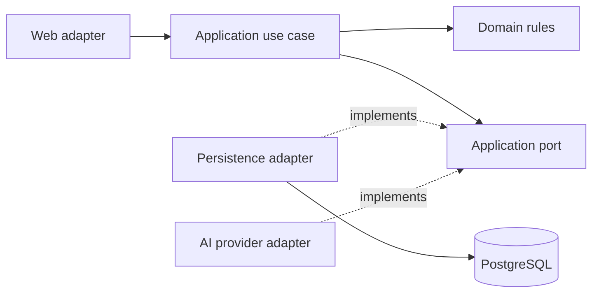

# Olarize architecture and folder organization

Olarize is a modular monolith: one Spring Boot application grouped by business capability, with clean dependency boundaries inside each module. The current implementation contains the platform/authentication foundation, ORG-001 company provisioning, EMP-001 trusted company context, IAM-001 membership administration, and IAM-002 PostgreSQL isolation for those existing tables. Product scope and future module ownership remain in .instructions/reference/product-v1.md and the development guidance.

## Dependency direction



Domain code uses Java and domain types, not Spring/HTTP/JPA/provider types. Application services orchestrate rules and ports; Spring transactions may be placed at the use-case boundary. Web adapters map DTOs, permissions and problem responses. Persistence/provider adapters implement ports. Dependency injection connects adapters to use cases. Avoid ceremonial interfaces for simple pure functions.

## Module layout when a real feature is added

```text
com.olarize.<module>/
  package-info.java                    Modulith boundary and allowed dependencies
  domain/model/                        Domain models and value objects
  domain/service/                      Domain services, when rules span models
  domain/event/                         Domain events, when emitted
  domain/exception/                     Module-owned business failures
  application/port/in/                 Use cases and public module contracts
  application/port/out/                Persistence/provider contracts
  application/service/                 Use cases, named *Service
  application/exception/               Use-case failures
  application/command/                 Write inputs, when needed
  application/query/                   Read inputs, when needed
  infrastructure/in/web/controller/           HTTP controllers
  infrastructure/in/web/dto/request/          *RequestDto input types
  infrastructure/in/web/dto/response/         *ResponseDto output types
  infrastructure/in/web/mapper/               HTTP boundary mapping
  infrastructure/in/web/configuration/        OpenAPI configuration
  infrastructure/in/messaging/                Inbound messages, when needed
  infrastructure/in/cli/                      Real command-line entry points
  infrastructure/out/persistence/entity/      JPA entities
  infrastructure/out/persistence/repository/  JPA and approved JDBC repositories
  infrastructure/out/persistence/mapper/      Persistence/domain conversions
  infrastructure/out/persistence/adapter/     Application output-port implementations
  infrastructure/out/messaging/               Outbound messages, when needed
  infrastructure/out/external/                External service adapters, when needed
```

Other modules call only the contracts exposed from `application/port/in`. Controllers and other input adapters call the same authorized application services. Domain failures are translated to HTTP in web adapters, never by adding HTTP status to domain objects. A future leave module must not query employment persistence directly. Use identifiers and module ports instead of cross-module JPA relationships. Create a folder only when it has real code; do not add empty layers for appearance.

## Required backend implementation standard

New business persistence uses Spring Data JPA for ordinary reads and writes: `*JpaEntity` maps database state, `*JpaRepository` provides persistence, a `*Mapper` converts between persistence and domain types, and a focused adapter implements the application port when the module boundary needs one. Controllers use dedicated `*RequestDto` and `*ResponseDto` DTOs and a web mapper for nontrivial conversions; they never return entities. Application `*Service` classes own use-case orchestration and transaction boundaries; domain classes own rules. Fixed business values use module-owned enums. Small reusable, stateless utilities are allowed only for actual shared technical behavior. Pattern choices must solve a concrete variation or boundary; do not create ceremonial layers.

Direct JDBC or native SQL is an exception for a documented PostgreSQL-specific need such as atomic audited mutation, row-level-security context, locking or bulk work that JPA cannot express safely and clearly. The exception must preserve tenant scope and transaction guarantees and have PostgreSQL integration coverage. Each port has one active implementation unless explicit, qualified alternatives are tested. Code review rejects duplicate beans, unused code, mixed HTTP/domain/persistence models, unclear names and undocumented exceptions. These rules apply to new features and persistence code being substantially changed; migrating existing JDBC modules is separate scoped work. See [ADR 004](decisions/004-jpa-and-backend-clean-code.md).

## Actual foundation

platform/internal/web contains request correlation, centralized HTTP errors and local OpenAPI setup. platform/internal/security contains the closed-by-default security chain. platform is technical infrastructure; it must never hold payroll, leave or other business logic. identity/infrastructure/in/web contains the current-user HTTP adapter and its endpoint documentation. Application entry point stays at com.olarize; this package is only the namespace root, not a place for feature classes. ArchitectureTests verifies Modulith dependencies and also enforces that future domain packages do not depend on framework/adapters.

PostgreSQL stores authoritative business data; pgvector will store authorized policy search data. S3 and Bedrock integrations are planned, not implemented. Flyway owns migrations; Hibernate validates. The existing identity and organization persistence classes still use JDBC; `MembershipJdbcMapper` maps membership SQL rows. They have not yet been migrated to the JPA standard above. Keycloak and the identity web adapter are implemented. Organization owns company identity and atomic creation evidence through the restricted provisioning command; its tables use RLS and explicit grants. Identity owns company memberships and the current-subject company-context API; it consumes organization contracts exposed from `application/port/in`. The controlled identity-administrator command uses a separate restricted role, atomic audit, and current-state membership revocation checks. IAM-001 adds company-scoped, preview/confirm administration for ordinary role bundles with Keycloak subject verification. IAM-002 limits current runtime company reads to a signed transaction-local subject and selected company with an active membership, guards administrative functions with the same proof, and constrains audit references to the same company. See [company provisioning](company-provisioning.md), [membership provisioning](identity-provisioning.md), [membership administration](membership-administration.md) and [company isolation](company-isolation.md).

## Future business module ownership

- identity: company memberships, roles and trusted request scope.
- organization: company identity; employment: employees, reporting lines and contract facts.
- leave and attendance: entitlement ledger, decisions, schedules and validated presence.
- payroll and socialprotection: preparation snapshots, reviewed CNSS/CIMR calculations and reconciliation. Payroll calls socialprotection with immutable inputs; avoid reverse dependencies.
- documents and knowledge: file publication/access, authorized indexing and RAG.
- assistant: bounded orchestration and exact confirmed tool proposals.
- notifications and audit: durable delivery and traceable business changes.

EMP-002 implements minimum employee creation in the employment module. EMP-004 adds recording and correcting supplied contract facts for an employment episode. Both use request/response DTOs, web mappers, JPA entities/repositories and transaction-bound services. Contract corrections append immutable versions with current-version checks, reasons, evidence references, actor/time/correlation audit facts and operation-scoped idempotency receipts. A focused PostgreSQL advisory transaction lock serializes equal retry keys; a JPA optimistic version prevents concurrent corrections from overwriting one another. The employee and contract tables force RLS using signed transaction scope and current employee.write or contract.write permissions. Contract type and date facts stay UNREVIEWED; legal validity, expiry consequences and employment/account changes are not inferred. Individual HTTP contracts live in `docs/api/employment/`. Directory/detail, accessible HR forms and document storage remain separate work. Domain purity checks cover the organization and employment rules.

## Accepted MVP data and hosting direction

[ADR 003](decisions/003-mvp-data-protection-and-hosting.md) targets managed Moroccan hosting for the MVP; no provider or production deployment is yet selected/verified. Keep the modular Spring backend, shared private PostgreSQL with application permissions and row-level security for current company and membership tables, private company-scoped document storage, separate Keycloak database and separate encrypted backups with verified locations. Future HR tables need their own RLS policies before use. Product AI/RAG is deferred for the current phase. External AI processing of real employee/confidential company data is excluded initially. Development tools use synthetic data and have no production-data access. Earlier S3/Bedrock/AWS descriptions are future alternatives, not deployed components.

Web transport types use the `Dto` suffix and live in separate files. Module utilities stay near their callers; shared `common/util` is reserved for generic technical functions with actual reuse. No common utility folder is currently needed.

Employment use-case failures (`EmployeeCreationConflict`, `ContractFactsConflict`, `ContractFactsNotFound`) live in `application/exception`. Domain business-rule failures belong in `domain/exception` when dedicated types are needed; HTTP translation stays in the web adapter.
