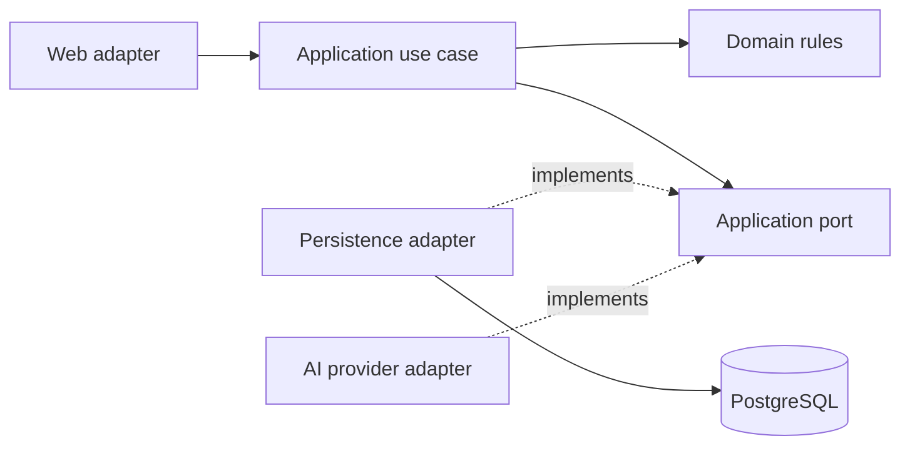

# Olarize architecture and folder organization

Olarize is a modular monolith: one Spring Boot application grouped by business capability, with clean dependency boundaries inside each module. The current implementation contains the platform/authentication foundation and ORG-001 company provisioning. Product scope and future module ownership remain in .instructions/reference/product-v1.md and the development guidance.

## Dependency direction



Domain code uses Java and domain types, not Spring/HTTP/JPA/provider types. Application services orchestrate rules and ports; Spring transactions may be placed at the use-case boundary. Web adapters map DTOs, permissions and problem responses. Persistence/provider adapters implement ports. Dependency injection connects adapters to use cases. Avoid ceremonial interfaces for simple pure functions.

## Module layout when a real feature is added

```text
com.olarize.<module>/
  package-info.java           Modulith boundary and allowed dependencies
  api/                        Public facade and cross-module contracts
  internal/
    domain/                   Rules, value objects, domain failures
    application/              Use cases and ports
    adapter/
      in/web/                 Controllers and request/response DTOs
      out/persistence/        JPA mapping and repositories
      out/provider/           External services, when needed
```

Other modules call only api. Controllers and AI tools call the same authorized use cases. Domain failures are translated to HTTP in web adapters, never by adding HTTP status to domain entities. A future leave module must not query employment repositories directly. Use identifiers and public APIs instead of cross-module JPA relationships. Do not create empty folders/classes to imitate this template.

## Actual foundation

platform/internal/web contains request correlation, centralized HTTP errors and local OpenAPI setup. platform/internal/security contains the closed-by-default security chain. platform is technical infrastructure; it must never hold payroll, leave or other business logic. identity/internal/adapter/in/web contains the current-user HTTP adapter and its endpoint documentation. Application entry point stays at com.olarize; this package is only the namespace root, not a place for feature classes. ArchitectureTests verifies Modulith dependencies and also enforces that future domain packages do not depend on framework/adapters.

PostgreSQL stores authoritative business data; pgvector will store authorized policy search data. S3 and Bedrock integrations are planned, not implemented. Flyway owns migrations; Hibernate validates. Keycloak and the identity web adapter are implemented. Organization now owns company identity and atomic creation evidence through the restricted provisioning command; its tables use RLS and explicit grants. Company memberships and their trusted request integration remain pending. See [company provisioning](company-provisioning.md).

## Future business module ownership

- identity: company memberships, roles and trusted request scope.
- organization: company identity; employment: employees, reporting lines and contract facts.
- leave and attendance: entitlement ledger, decisions, schedules and validated presence.
- payroll and socialprotection: preparation snapshots, reviewed CNSS/CIMR calculations and reconciliation. Payroll calls socialprotection with immutable inputs; avoid reverse dependencies.
- documents and knowledge: file publication/access, authorized indexing and RAG.
- assistant: bounded orchestration and exact confirmed tool proposals.
- notifications and audit: durable delivery and traceable business changes.

Except for identity authentication and organization provisioning, these business capabilities remain planned. Domain purity checks cover the organization registration rules.

## Accepted MVP data and hosting direction

[ADR 003](decisions/003-mvp-data-protection-and-hosting.md) targets managed Moroccan hosting for the MVP; no provider or production deployment is yet selected/verified. Keep the modular Spring backend, shared private PostgreSQL with application permissions plus row-level security to implement, private company-scoped document storage, separate Keycloak database and separate encrypted backups with verified locations. Product AI/RAG is deferred for the current phase. External AI processing of real employee/confidential company data is excluded initially. Development tools use synthetic data and have no production-data access. Earlier S3/Bedrock/AWS descriptions are future alternatives, not deployed components.
