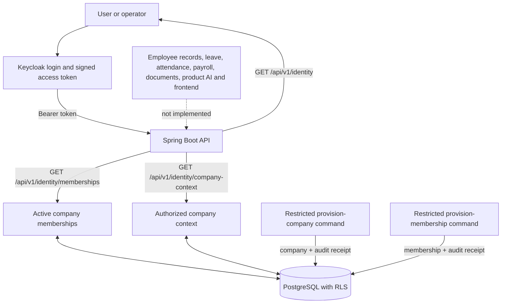
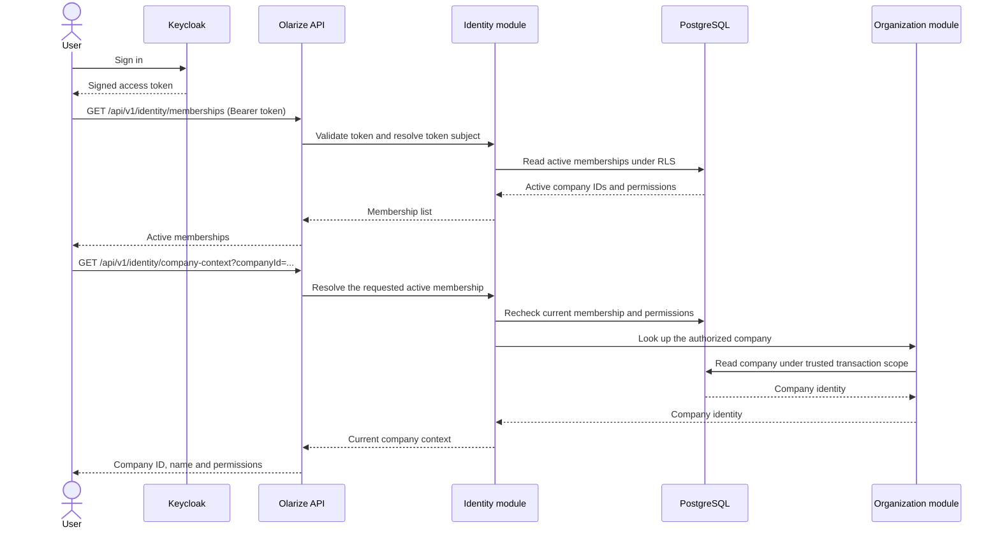

# Features and current flows

This page shows what is implemented in the Olarize product backend today, what is still planned, and how to verify the implemented slices. It describes backend behavior; there is no Olarize product frontend yet.

## Current feature map



The two provisioning commands are controlled operator workflows. They are not public API routes and do not start the web server.

## User request flow today



The API derives identity from the verified token. A requested company ID selects a target but does not grant access. Membership changes are rechecked on each request. If there is one active membership, company context can be selected without a `companyId`; with multiple memberships the caller must specify one.

## Feature status and how to check

| Feature | Status | Safe automated check | Manual check |
|---|---|---|---|
| Keycloak authentication and `GET /api/v1/identity` | Implemented | `./scripts/verify-backend.sh` | Start the local stack, sign in with a synthetic Keycloak user in local Swagger, then call `GET /api/v1/identity`. Or run `python3 scripts/smoke-keycloak.py` against a healthy local stack. |
| ORG-001 company provisioning | Implemented locally; production operator setup remains pending | `./scripts/verify-backend.sh` includes PostgreSQL authorization, audit, retry and failure tests. | Follow [company provisioning](company-provisioning.md). This command writes company and audit rows; use a synthetic company and the restricted operator credential only. |
| EMP-001 membership list and company context | Implemented locally; production identity-operator setup remains pending | `./scripts/verify-backend.sh` includes signed-token HTTP and PostgreSQL membership tests. | Start the local stack and use local Swagger. Call `GET /api/v1/identity/memberships`, then `GET /api/v1/identity/company-context` or pass a membership's `companyId`. A local membership must first be provisioned using the restricted procedure in [identity provisioning](identity-provisioning.md). |
| Employee records, leave, attendance, payroll, documents, product AI and frontend | Not implemented | No feature test exists yet | Track these in the requirements and task files; do not treat a planned flow as usable functionality. |

## Run the checks

From the repository root, with Docker available:

```sh
./scripts/verify-backend.sh
```

This runs the unit, architecture, signed-token HTTP and disposable PostgreSQL integration tests, then packages the backend. It does not provision a local company or membership and does not test a production deployment. Current recorded EMP-001 evidence is in [task 005](../.instructions/tasks/005-company-context.md); the command above reruns the checks against your current checkout.

For hands-on API checks:

```sh
docker compose --profile app up -d --build --wait
```

Then open [local Swagger](http://localhost:8080/swagger-ui/index.html), choose the Keycloak `profile.read` authorization, and sign in as a synthetic local user. Swagger and its login flow are available only in the local profile. See [local authentication](authentication.md) for account setup and [development](development.md) for startup and troubleshooting.

To stop the stack while preserving local data:

```sh
docker compose --profile app down
```

## Development workflow versus product flow

Implementing code follows a separate workflow: approved story → ticket branch → implementation → automated checks → independent review → commit/PR. That is the developer workflow, not an Olarize HR feature. See [understanding the workflow](understanding-the-workflow.md) and [development workflow rules](../.instructions/development-workflow.md).
