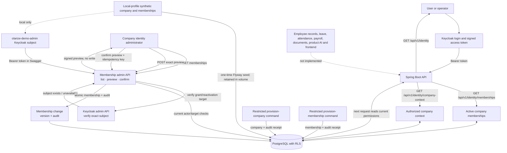
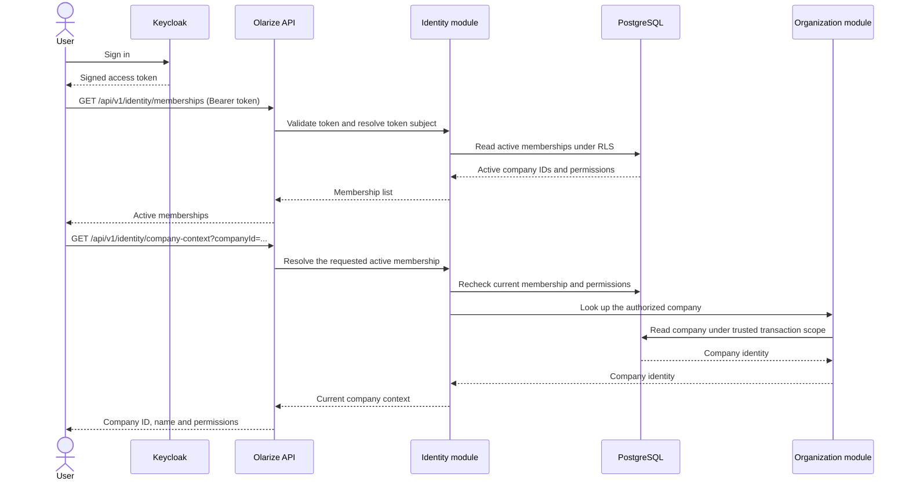

# Features and current flows

This page shows what is implemented in the Olarize product backend today, what is still planned, and how to verify the implemented slices. It describes backend behavior; there is no Olarize product frontend yet.

## Current feature map



The two provisioning commands are controlled operator workflows. They are not public API routes and do not start the web server.

## Company membership administration flow (IAM-001)

```mermaid
sequenceDiagram
    actor Admin as Company identity administrator
    participant API as Membership admin API
    participant Identity as Identity application service
    participant KC as Keycloak admin API
    participant DB as PostgreSQL
    participant Target as Target member

    Admin->>API: GET /api/v1/companies/{companyId}/memberships
    API->>Identity: Resolve signed-token subject
    Identity->>DB: Check current active identity.admin and list company members
    DB-->>API: Scoped membership list
    API-->>Admin: Subjects, roles, permissions and versions

    Admin->>API: POST membership-change-previews
    API->>Identity: Validate requested action and role bundle
    opt Grant or reactivation
        Identity->>KC: Verify exact Keycloak subject
        KC-->>Identity: Exists, missing or unavailable
    end
    Identity-->>API: Signed exact preview, expires in 30 minutes
    API-->>Admin: Preview token, action, permissions and versions (no write)

    Admin->>API: POST membership-changes/confirm
    API->>Identity: Validate actor, preview and idempotency key
    Identity->>DB: Recheck actor/target versions; lock and write membership + audit atomically
    DB-->>Identity: Committed result, or prior result for an exact retry
    Identity-->>API: Current membership state
    API-->>Admin: Confirmed result
    Target->>API: Next request with the same signed access token
    API->>DB: Read current membership and permissions
    DB-->>API: Updated scope, or deny if revoked
```

The company ID in the URL only selects the requested scope. Every route checks the caller's current active `identity.admin` membership in PostgreSQL. The API cannot manage itself or another identity administrator. Grants and reactivations require the Keycloak user lookup; ordinary revocation still works if Keycloak is unavailable. Membership changes are stored in PostgreSQL, so a still-valid access token does not preserve removed permissions.

## User request flow today



The API derives identity from the verified token. A requested company ID selects a target but does not grant access. Membership changes are rechecked on each request. If there is one active membership, company context can be selected without a `companyId`; with multiple memberships the caller must specify one.

## Feature status and how to check

| Feature | Status | Safe automated check | Manual check |
|---|---|---|---|
| Keycloak authentication and `GET /api/v1/identity` | Implemented | `./scripts/verify-backend.sh` | Start the local stack, sign in with a synthetic Keycloak user in local Swagger, then call `GET /api/v1/identity`. Or run `python3 scripts/smoke-keycloak.py` against a healthy local stack. |
| ORG-001 company provisioning | Implemented locally; production operator setup remains pending | `./scripts/verify-backend.sh` includes PostgreSQL authorization, audit, retry and failure tests. | Follow [company provisioning](company-provisioning.md). This command writes company and audit rows; use a synthetic company and the restricted operator credential only. |
| EMP-001 membership list and company context | Implemented locally; production identity-operator setup remains pending | `./scripts/verify-backend.sh` includes signed-token HTTP and PostgreSQL membership tests. | Start the local stack and sign into Swagger as `olarize-demo-admin` (setup in [local authentication](authentication.md)). `GET /api/v1/identity/memberships` returns the seeded demo company membership; `GET /api/v1/identity/company-context` returns its company and permissions. The local demo member has an ordinary `EMPLOYEE` membership for demonstrating role-specific results. |
| IAM-001 company membership administration | Implemented locally; production identity-admin authority remains gated by OD-03 | `./scripts/verify-backend.sh` exercises list, grant, role change, reactivation, revocation, provider failures, audit rollback, retries, concurrency and next-request permissions with PostgreSQL Testcontainers and synthetic signed tokens. | Sign into local Swagger as `olarize-demo-admin`. Use the company ID returned by `GET /api/v1/identity/memberships` to call `GET /api/v1/companies/{companyId}/memberships`; it returns both seeded subjects. For writes, configure the local Keycloak admin service account per [membership administration](membership-administration.md), then preview and confirm a membership change. This synthetic local identity-admin record is not production authority. |
| Employee records, leave, attendance, payroll, documents, product AI and frontend | Not implemented | No feature test exists yet | Track these in the requirements and task files; do not treat a planned flow as usable functionality. |

## Run the checks

From the repository root, with Docker available:

```sh
./scripts/verify-backend.sh
```

This runs the unit, architecture, signed-token HTTP and disposable PostgreSQL integration tests, then packages the backend. Local Swagger demo rows use a separate Flyway location enabled only by the local profile; they are not test fixtures and remain in the PostgreSQL volume across app restarts. This command does not test a production deployment. Current recorded IAM-001 evidence is in [task 006](../.instructions/tasks/006-membership-administration.md); EMP-001 evidence is in [task 005](../.instructions/tasks/005-company-context.md). The command reruns checks against your current checkout.

For hands-on API checks:

```sh
docker compose --profile app up -d --build --wait
```

Then open [local Swagger](http://localhost:8080/swagger-ui/index.html), choose the Keycloak `profile.read` authorization, and sign in as a synthetic local user. Swagger and its login flow are available only in the local profile. See [local authentication](authentication.md) for account setup and [development](development.md) for startup and troubleshooting.

To stop the stack while preserving local data:

```sh
docker compose --profile app down
```

## Development workflow versus product flow

Implementing code follows a separate workflow: approved story → ticket branch → implementation → automated checks → independent review → commit/PR. That is the developer workflow, not an Olarize HR feature. See [understanding the workflow](understanding-the-workflow.md) and [development workflow rules](../.instructions/development-workflow.md).
