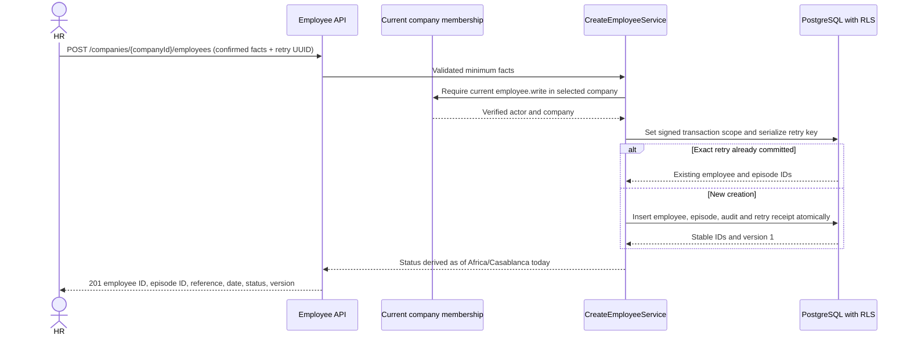
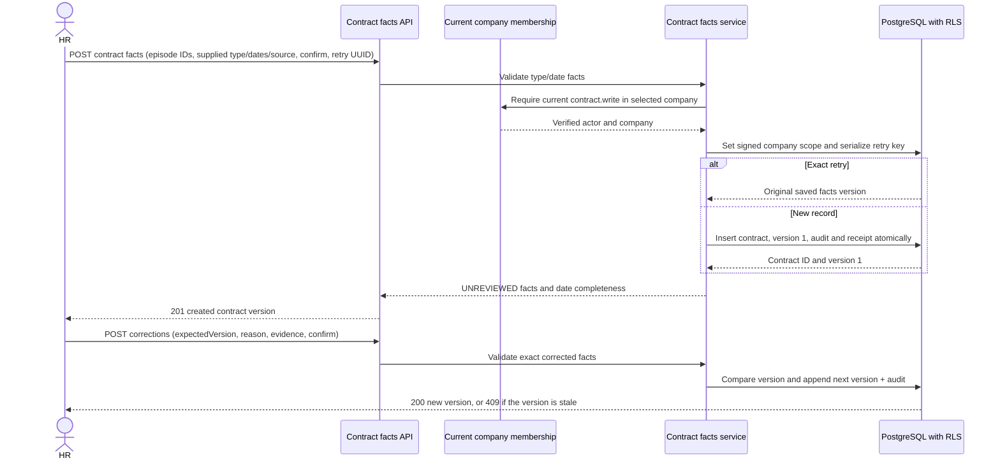
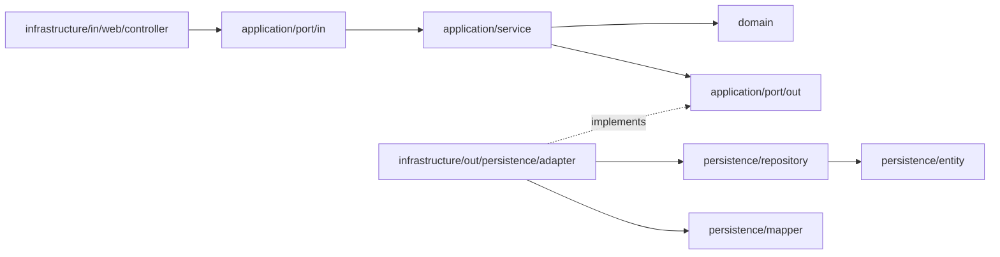
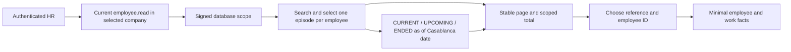
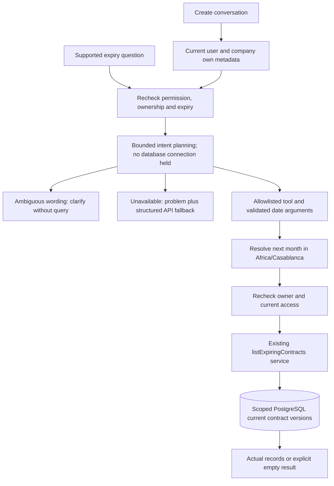

# Features and current flows

This page shows what is implemented in the Olarize product backend today, what is still planned, and how to verify the implemented slices. It describes backend behavior; there is no Olarize product frontend yet.

## Current feature map

```mermaid
flowchart TD
    User[User or operator]
    Keycloak[Keycloak login and signed access token]
    API[Spring Boot API]
    Memberships[Active company memberships]
    Company[Authorized company context]
    Admin[Company identity administrator]
    AdminAPI[Membership admin API<br/>list · preview · confirm]
    KeycloakAdmin[Keycloak admin API<br/>verify exact user ID]
    Change[Membership change<br/>version + audit]
    DB[(PostgreSQL with enforced company RLS)]
    Scope[Signed subject + selected company<br/>transaction-local database context]
    ScopeKey[Private PostgreSQL scope key]
    ProvisionCompany[Restricted provision-company command]
    ProvisionMembership[Restricted provision-membership command]
    HR[HR member with employee.write]
    CreateEmployee[POST /companies/{companyId}/employees]
    EmployeeRecord[Employee + first episode + audit]
    ContractHR[HR member with contract.write]
    ContractAPI[POST contract facts · POST correction]
    ContractVersions[Contract + retained facts versions + audit]

    User --> Keycloak
    Keycloak -->|Bearer token| API
    API -->|GET /api/v1/identity| User
    API -->|GET /api/v1/identity/memberships| Memberships
    API -->|GET /api/v1/identity/company-context| Company
    Memberships -->|signed subject; own active rows only| DB
    Company --> Scope
    Scope -->|proof + current active membership required| DB
    ScopeKey -->|verify proof| DB
    Admin -->|GET memberships| AdminAPI
    Admin -->|POST exact preview| AdminAPI
    AdminAPI -->|verify grant/reactivation target| KeycloakAdmin
    KeycloakAdmin -->|user exists / unavailable| AdminAPI
    AdminAPI -->|signed preview, no write| Admin
    Admin -->|confirm preview + idempotency key| AdminAPI
    AdminAPI -->|current actor/target checks| DB
    AdminAPI -->|atomic membership + audit| Change
    Change --> DB
    DB -->|next request reads current permissions| API
    ProvisionCompany -->|company + audit receipt| DB
    ProvisionMembership -->|membership + audit receipt| DB
    HR -->|confirmed minimum facts + retry UUID| CreateEmployee
    CreateEmployee -->|current company membership + signed scope| DB
    CreateEmployee -->|one transaction| EmployeeRecord
    EmployeeRecord --> DB
    HR -->|current versions + confirmed work facts + reason + effective date| CorrectionAPI[POST employee episode corrections]
    CorrectionAPI -->|signed scope; optimistic versions; atomic audit| EmployeeVersions[Immutable employee source versions]
    EmployeeVersions --> DB
    CorrectionAPI --> JobVersions[Dated minimal job projection]
    JobVersions --> DB
    ContractHR -->|confirmed supplied facts + retry UUID| ContractAPI
    ContractAPI -->|current contract permission + signed scope| DB
    ContractAPI -->|append version, audit and receipt atomically| ContractVersions
    ContractVersions --> DB
    ContractHR -->|inclusive date range| ExpiryAPI[GET /companies/{companyId}/contracts/expiring]
    ExpiryAPI -->|current contract.read + signed scope| DB
    DB -->|current versions + missing-date count| ExpiryAPI
    ExpiryAPI -->|bounded page, stable order| ContractHR
    DirectoryHR[HR member with employee.read]
    DirectoryHR -->|name, reference, status and date| DirectoryAPI[GET company employees]
    DirectoryAPI -->|signed company scope; bounded page and count| DB
    DirectoryAPI -->|employee ID selected by HR| DetailAPI[GET company employee detail]
    DetailAPI -->|same current permission and scope| DB
    DB -->|minimal work facts and selected episode| DirectoryHR
    ToolHR[HR with contract.read]
    ToolHR -->|create owned conversation| ConversationAPI[Assistant backend]
    ConversationAPI -->|owner/company metadata and RLS| DB
    ConversationAPI -->|question only; bounded local evaluation| Planner[Synthetic intent planner]
    Planner -->|allowlisted date intent| ExpiryTool[Validated expiry tool]
    ExpiryTool -->|public employment service; current permission| ExpiryAPI
    ExpiryTool -->|actual records or explicit empty/clarification/error| ToolHR
    LocalSeed[Local-profile synthetic company and memberships]
    LocalSeed -->|one-time Flyway seed; retained in volume| DB
    LocalSeed -. local only .-> DemoAdmin[olarize-demo-admin user ID]
    DemoAdmin -->|Bearer token in Swagger| AdminAPI

    Planned[Employee directory, leave, attendance, payroll, documents, product AI and frontend]
    Planned -. not implemented .-> API
```

The two provisioning commands are controlled operator workflows. They are not public API routes and do not start the web server.

## Minimum employee creation flow (EMP-002 backend)



This API records factual minimum employment data. The accessible creation form awaits UI-DEP; no product frontend exists yet. An HR user can test the backend with local Swagger as described in [employee creation](employment-creation.md).

## Contract facts and correction flow (EMP-004 backend)



Contract type codes are recorded as supplied labels, and every version remains `UNREVIEWED`. The API does not assess legality, renewal, payroll eligibility, or employment/account state. A missing end date is `NOT_RECORDED`; no expiry is guessed. These endpoints have individual contracts in [`docs/api/employment/`](api/employment/) and Swagger examples use the persistent synthetic contract in [contract facts](employment-contract-facts.md). The accessible form and document upload remain separate work.

## Contract expiry list flow (EMP-005 backend)

```mermaid
sequenceDiagram
    actor HR
    participant API as Expiring contracts API
    participant Identity as Current company membership
    participant Service as ListExpiringContractsService
    participant DB as PostgreSQL with RLS
    HR->>API: GET contracts/expiring?fromDate=...&toDate=...
    API->>Service: Validate inclusive date window and page bounds
    Service->>Identity: Require current contract.read in selected company
    Identity-->>Service: Verified actor and company
    Service->>DB: Set signed scope; query current versions and company coverage
    DB-->>Service: Ordered page and missing-end-date count
    Service-->>API: Result with date window, timezone and pagination
    API-->>HR: 200 current contract facts (empty items when no matches)
```

The endpoint selects current versions only and sorts by recorded end date then contract ID. The inclusive date window is limited to 366 days, with 25 rows per page by default and a maximum of 100. The separate missing-end-date count covers current contracts in the selected company; it does not imply they expire. See [the contract expiry list](employment-contract-expiry.md) for the persistent Swagger example and exact call.

## Company membership administration flow (IAM-001)

```mermaid
sequenceDiagram
    actor Admin as Company identity administrator
    participant API as Membership admin API
    participant Identity as Identity application service
    participant KC as Keycloak admin API
    participant DB as PostgreSQL
    participant Target as Target member

    Admin->>API: GET /api/v1/companies/{companyId}/memberships
    API->>Identity: Read signed-in user ID from token
    Identity->>DB: Check current active identity.admin and list company members
    DB-->>API: Scoped membership list
    API-->>Admin: Member user IDs, roles, permissions and versions

    Admin->>API: POST membership-change-previews
    API->>Identity: Validate requested action and role bundle
    opt Grant or reactivation
        Identity->>KC: Verify exact Keycloak user ID
        KC-->>Identity: Exists, missing or unavailable
    end
    Identity-->>API: Signed exact preview, expires in 30 minutes
    API-->>Admin: Preview token, action, permissions and versions (no write)

    Admin->>API: POST membership-changes/confirm
    API->>Identity: Validate actor, preview and idempotency key
    Identity->>DB: Recheck actor/target versions; lock and write membership + audit atomically
    DB-->>Identity: Committed result, or prior result for an exact retry
    Identity-->>API: Current membership state
    API-->>Admin: Confirmed result
    Target->>API: Next request with the same signed access token
    API->>DB: Read current membership and permissions
    DB-->>API: Updated scope, or deny if revoked
```

The company ID in the URL only selects the requested scope. Every route checks the caller's current active `identity.admin` membership in PostgreSQL. The API cannot manage itself or another identity administrator. Grants and reactivations require the Keycloak user lookup; ordinary revocation still works if Keycloak is unavailable. Membership changes are stored in PostgreSQL, so a still-valid access token does not preserve removed permissions.

The membership administration service uses one persistence adapter, `MembershipAdministrationJdbcRepository`. A clean backend verification confirms Spring starts with that single port implementation; this fixes the duplicate-bean failure seen in CI after the repository rename.

## User request flow today

```mermaid
sequenceDiagram
    actor User
    participant KC as Keycloak
    participant API as Olarize API
    participant Identity as Identity module
    participant DB as PostgreSQL
    participant Org as Organization module

    User->>KC: Sign in
    KC-->>User: Signed access token
    User->>API: GET /api/v1/identity/memberships (Bearer token)
    API->>Identity: Validate token and resolve token subject
    Identity->>DB: Sign verified subject for this transaction; read own active memberships
    DB-->>Identity: Active company IDs and permissions
    Identity-->>API: Membership list
    API-->>User: Active memberships
    User->>API: GET /api/v1/identity/company-context?companyId=...
    API->>Identity: Resolve the requested active membership
    Identity->>DB: Recheck current membership and permissions
    Identity->>Org: Look up the authorized company
    Org->>DB: Sign verified subject and company for this transaction; read company under RLS
    DB-->>Org: Company identity
    Org-->>Identity: Company identity
    Identity-->>API: Current company context
    API-->>User: Company ID, name and permissions
```

The API derives identity from the verified token. A requested company ID selects a target but does not grant access. PostgreSQL checks the signed transaction scope and requires a current active membership for its subject and selected company. The context clears when the transaction commits or rolls back. Membership changes are rechecked on each request. If there is one active membership, company context can be selected without a `companyId`; with multiple memberships the caller must specify one.

## Feature status and how to check

| Feature | Status | Safe automated check | Manual check |
|---|---|---|---|
| Keycloak authentication and `GET /api/v1/identity` | Implemented | `./scripts/verify-backend.sh` | Start the local stack, sign in with a synthetic Keycloak user in local Swagger, then call `GET /api/v1/identity`. Or run `python3 scripts/smoke-keycloak.py` against a healthy local stack. |
| ORG-001 company provisioning | Implemented locally; production operator setup remains pending | `./scripts/verify-backend.sh` includes PostgreSQL authorization, audit, retry and failure tests. | Follow [company provisioning](company-provisioning.md). This command writes company and audit rows; use a synthetic company and the restricted operator credential only. |
| EMP-001 membership list and company context | Implemented locally; production identity-operator setup remains pending | `./scripts/verify-backend.sh` includes signed-token HTTP and PostgreSQL membership tests. | Start the local stack and sign into Swagger as `olarize-demo-admin` (setup in [local authentication](authentication.md)). `GET /api/v1/identity/memberships` returns the seeded demo company membership; `GET /api/v1/identity/company-context` returns its company and permissions. The local demo member has an ordinary `EMPLOYEE` membership for demonstrating role-specific results. |
| IAM-001 company membership administration | Implemented locally; production identity-admin authority remains gated by OD-03 | `./scripts/verify-backend.sh` exercises list, grant, role change, reactivation, revocation, provider failures, audit rollback, retries, concurrency and next-request permissions with PostgreSQL Testcontainers and synthetic signed tokens. Generated Swagger declares `profile.read` on the company membership list, preview and confirmation operations so it sends the authorized access token. The persistence classes use searchable `JdbcRepository` names and `MembershipJdbcMapper` handles SQL rows. | Sign into local Swagger as `olarize-demo-admin`. Use the company ID returned by `GET /api/v1/identity/memberships` to list that company's memberships, then copy the chosen row's `userId` into the preview request. The seeded ordinary member supports a role-change preview. New grants and reactivations need the local Keycloak admin service account described in [membership administration](membership-administration.md). This synthetic local identity-admin record is not production authority. |
| IAM-002 PostgreSQL company isolation | Implemented for current organization and identity tables using a signed database scope | `./scripts/verify-backend.sh` runs restricted-runtime PostgreSQL tests for missing/forged scope, administrator impersonation, cross-company reads, joins, aggregates, revocation, audit references, transaction cleanup and role privileges. | In local Swagger, sign in as `olarize-demo-admin`; the existing membership and company-context endpoints return the seeded Demo Morocco SARL data. Sign in as a user without that company membership to check access denial. IAM-002 adds no new HTTP endpoint; see [company isolation](company-isolation.md). |
| EMP-002 minimum employee creation | Backend API implemented; accessible form awaits UI-DEP | `./scripts/verify-backend.sh` covers confirmed creation, same-key retry, duplicate company reference, permission/scope denial, audit rollback and restricted-runtime RLS. | Sign into local Swagger as `olarize-demo-admin`, choose the seeded company, and POST a new reference such as `EMP-0007`; see [employee creation](employment-creation.md). |
| EMP-004 contract facts | Backend create/correction APIs implemented; accessible review form and document storage remain separate | `./scripts/verify-backend.sh` covers date and type validation, company permission/RLS, version history, exact retries, stale/concurrent corrections and atomic audit rollback. | Sign into local Swagger as `olarize-demo-admin`. Use the seeded company, employee, episode and contract IDs; see [contract facts](employment-contract-facts.md). |
| EMP-005 contract expiry list | Backend read API implemented and verified; notifications and renewal decisions remain separate | Tests cover inclusive windows, current versions, deterministic pagination, missing-date coverage, company isolation and `contract.read` authorization; Full backend verification passed: 97 tests, including PostgreSQL integration and local OpenAPI. | Sign into local Swagger as `olarize-demo-admin`, then call `GET /api/v1/companies/c0000000-0000-4000-8000-000000000001/contracts/expiring?fromDate=2027-01-01&toDate=2027-12-31`; it returns Yasmine Bennani's seeded contract. See [contract expiry list](employment-contract-expiry.md). |
| Employee directory, leave, attendance, payroll, documents, product AI and frontend | Not implemented | No feature test exists yet | Track these in the requirements and task files; do not treat a planned flow as usable functionality. |

The local Swagger integration check starts a disposable PostgreSQL container for both the API datasource and Flyway migrations. CI does not need the developer's database on `localhost:5433`; a missing local database no longer prevents the Swagger contract tests from starting.

## Run the checks

From the repository root, with Docker available:

```sh
./scripts/verify-backend.sh
```

This runs the unit, architecture, signed-token HTTP and disposable PostgreSQL integration tests, then packages the backend. Local Swagger demo rows use a separate Flyway location enabled only by the local profile; they are not test fixtures and remain in the PostgreSQL volume across app restarts. This command does not test a production deployment. Current EMP-005 evidence is in [task 010](../.instructions/tasks/010-expiring-contracts.md); EMP-004 evidence is in [task 009](../.instructions/tasks/009-contract-facts.md); EMP-002 evidence is in [task 008](../.instructions/tasks/008-minimum-employee-record.md). The command reruns checks against your current checkout.

For hands-on API checks:

```sh
docker compose --profile app up -d --build --wait
```

Then open Swagger on the configured `BACKEND_PORT` (for example `http://localhost:8082/swagger-ui/index.html`), choose the Keycloak `profile.read` authorization, and sign in as a synthetic local user. Swagger and its login flow are available only in the local profile. See [local authentication](authentication.md) for account setup and [development](development.md) for startup and troubleshooting.

To stop the stack while preserving local data:

```sh
docker compose --profile app down
```

## Development workflow versus product flow

Implementing code follows a separate workflow: approved story → ticket branch → implementation → automated checks → independent review → commit/PR. That is the developer workflow, not an Olarize HR feature. See [understanding the workflow](understanding-the-workflow.md) and [development workflow rules](../.instructions/development-workflow.md).

## Swagger examples for the local demo

Swagger examples now use Demo Morocco SARL (`c0000000-0000-4000-8000-000000000001`), its demo administrator (user ID ending `0011`) and ordinary member (user ID ending `0021`). These match the existing persistent local SQL seed; examples do not insert or reset records.

EMP-002 adds an explicit local `employee.write` grant to `olarize-demo-admin` and a persistent synthetic employee `EMP-0001`. Swagger's create example uses a fresh reference `EMP-0007` and returns actual saved IDs when executed; see [employee creation](employment-creation.md).

Sign in as `olarize-demo-admin`, list the company memberships, then copy the chosen row's `userId` into the preview request. `GET /api/v1/identity` returns `currentUserId` for the signed-in person; it is only needed to check who is signed in. The demo preview changes the ordinary member from `EMPLOYEE` to `MANAGER`. Copy the returned `previewToken` and `targetVersion` into the confirmation request and use a new UUID as the idempotency key. Reuse that UUID only for an identical retry. The documented token placeholder cannot be executed. Confirmation updates the existing membership and appends an audit record. A second attempt needs current data and a different requested role if the member is already a manager. Response examples describe the initial seed and the first successful change; use actual responses for current state.

### Web package organization

Identity and employment HTTP adapters now separate controllers, request/response DTOs, mappers and OpenAPI configuration. Transport classes use `RequestDto`/`ResponseDto`; endpoint URLs and JSON fields are unchanged. `./scripts/verify-backend.sh` passed all 97 tests after the move, including compilation, PostgreSQL/HTTP integration, local OpenAPI and architecture checks.

Employment exception organization: creation conflicts, contract conflicts and missing contract records now live in `application/exception`. Their existing HTTP mappings and feature flows are unchanged. Verified with production/test compilation and both architecture tests passing; focused independent review found no issues.

### Infrastructure layout

All employment, identity and organization technical adapters now live under `infrastructure/in` and `infrastructure/out`. Persistence separates entities, repositories, mappers and port adapters. The application ports and endpoint flows remain unchanged; JPA entity fields remain private across the new package boundaries. `./scripts/verify-backend.sh` passed all 97 tests after this move, including PostgreSQL, HTTP, Swagger and architecture checks. Independent review found no actionable issues.



The independent review documentation finding is resolved: README and the hexagonal draft now show the infrastructure layout and implemented employment module. The draft labels runtime flow separately from Java dependencies on ports.

## Employee directory and detail — OLARIZE-6 / EMP-003

Implemented backend search and detail with separate controllers, DTOs/mappers and JPA persistence under `infrastructure`. The frontend remains pending under UI-DEP.



Local Swagger: log in as `olarize-demo-admin`, use company `c0000000-0000-4000-8000-000000000001`, then GET employees with `search=Ahmed&asOf=2026-09-30` for two distinct Ahmed references. GET detail using employee `c0000000-0000-4000-8000-000000000080`. `status=ALL` returns five persistent demo rows; ENDED returns Nadia and UPCOMING returns Omar on that date. Default CURRENT omits ended/upcoming records. See [employee directory](employee-directory.md) for parameters, IDs and response details.

Verification: full backend checks pass, including domain/service unit tests, company isolation and revoked-access HTTP checks, outage errors, persistent local seed checks and generated Swagger examples. Database errors remain errors; genuine no-match queries may be empty. Contract expiry does not decide employment status.

Review correction: pagination that exceeds JPA's integer row-offset limit now returns 400. Domain boundary and authenticated HTTP checks cover the limit.

## Contract expiry tool backend — OLARIZE-5 / EMP-006

The user authorized the backend slice with a local synthetic provider. Conversation UI and live model integration remain pending.



Swagger: POST `/companies/{companyId}/assistant/conversations`, copy its real conversationId, then POST `/{conversationId}/contract-expiry-requests` with question `Which contracts expire in October 2026?`. Use `olarize-demo-admin` and company `c0000000-0000-4000-8000-000000000001`. Persistent local V907 gives Yasmine a synthetic contract ending 2026-10-15. No startup conversation is shared between users. See [assistant expiry guide](assistant-contract-expiry.md) for multilingual examples, limits and fallback.

Verification: full backend checks passed 117 tests; the subsequent direct ownership/RLS regression passed 32 focused tests. Independent review found no actionable issues. These are deterministic provider evaluations; frontend, live browser login, general language understanding and live-provider acceptance remain separate.

## Employee corrections — OLARIZE-7 / EMP-007 backend

HR submits one explicit correction for an employee/episode with current versions, a reason and job effective date. Immutable history and safe retries preserve prior evidence. Start conflicts identify dependent job/episode/last-day facts. Directory/detail select job facts by asOf; restricted reasons/history are hidden from directory readers. Existing contracts and source snapshots retain their dates/facts. See [employee corrections](employee-corrections.md) for persistent local Swagger calls, fields and errors.

Verify via `./scripts/verify-backend.sh`; correction tests cover effective dates, immutable source preservation, invalid/denied/foreign writes, audit rollback, stale/duplicate/concurrent writes and restricted PostgreSQL scope. Accessible UI and future reporting/payroll integration remain pending.

Verified 2026-10-01: 127 full-suite tests passed; final date-boundary correction passed 47 focused tests. Independent review found no actionable issues. V12/V908 and synthetic baselines were applied to persistent local PostgreSQL; generated Swagger contract passed the local smoke check. Jira completion remains pending UI acceptance.

Correction retry timestamps use PostgreSQL microsecond precision for both the first response and persisted retries. A deterministic PostgreSQL regression supplies a nanosecond instant and verifies identical initial/replayed outcomes; existing HTTP exact-response and concurrent retry assertions remain in place. Full verification passed 128 tests with no failures/errors/skips on 2026-10-01; focused independent review found no actionable issues.
