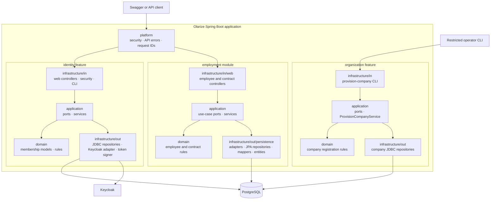
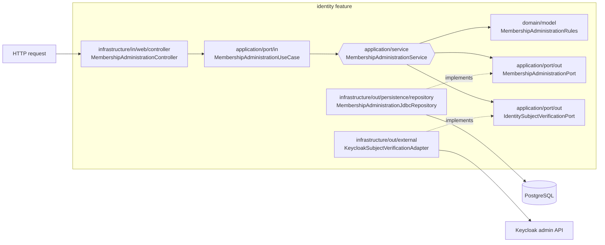

# Draft: Olarize features and hexagonal layers

This is a visual guide to the backend as it exists today. Olarize is one Spring Boot application with three implemented business modules, `identity`, `organization` and `employment`. Each feature owns its domain, application logic and adapters. `platform` supplies shared security, API errors and request IDs. Employment implements employee creation, versioned contract facts and the contract expiry list. Leave, payroll and the other planned modules remain separate work.

## Features first, layers inside each feature



The arrows above show runtime request flow, not Java dependency direction. Application code depends on ports; infrastructure implementations provide those ports and never become application dependencies. Each feature keeps its code together; there is no single project-wide `controllers/`, `services/` or `repositories/` folder.

## Zoom in: changing a company membership



The **incoming adapter** translates HTTP into a use-case call. The **incoming port** says what the application offers. The **service** runs the membership rules. The **outgoing ports** say what the service needs from storage and Keycloak. The **outgoing adapters** provide those capabilities. Dotted arrows mean “implements this port.” In source code, the service depends on port interfaces; dependency injection connects it to the adapters.

For this feature, `MembershipJdbcMapper` converts SQL rows to domain `Membership` objects. Controllers, request DTOs, response DTOs, web mappers and OpenAPI configuration have separate folders under `infrastructure/in/web`. Transport classes use `RequestDto`/`ResponseDto` suffixes. Identity and organization retain approved JDBC repositories; employment uses JPA entities and Spring Data repositories. Persistence classes live in `entity`, `repository`, `mapper` and `adapter` subfolders as needed.

## Folder shape

```text
com/olarize/
├── identity/
│   ├── domain/
│   ├── application/
│   │   ├── port/in/      use cases called by controllers
│   │   ├── port/out/     contracts needed by services
│   │   └── service/      business workflow
│   └── infrastructure/
│       ├── in/           web, security and CLI entry points
│       └── out/          JDBC, Keycloak and token implementations
├── organization/
│   ├── domain/
│   ├── application/
│   └── infrastructure/
├── employment/
│   ├── domain/
│   ├── application/
│   │   ├── port/in/
│   │   ├── port/out/
│   │   ├── service/
│   │   └── exception/
│   └── infrastructure/
│       ├── in/web/
│       │   ├── controller/
│       │   ├── dto/request/
│       │   ├── dto/response/
│       │   ├── mapper/
│       │   └── configuration/
│       └── out/persistence/
│           ├── entity/
│           ├── repository/
│           ├── mapper/
│           └── adapter/
└── platform/             shared technical infrastructure
```

Some subfolders are absent until real code needs them. This diagram is a draft explanation of the current backend, not a proposal to create empty packages.
