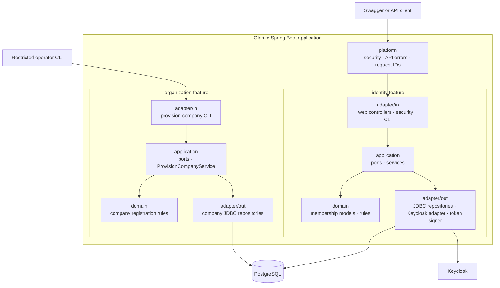
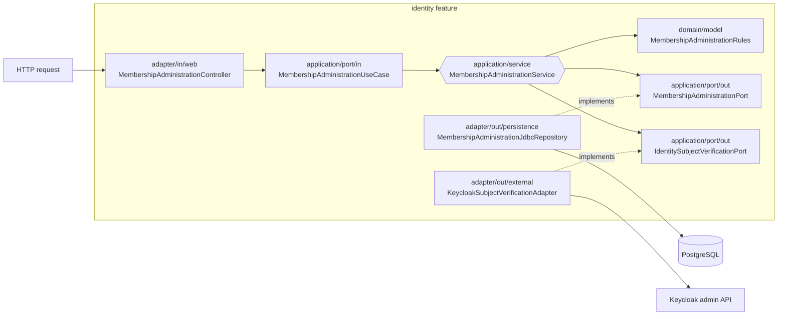

# Draft: Olarize features and hexagonal layers

This is a visual guide to the backend as it exists today. Olarize is one Spring Boot application with two implemented business features, `identity` and `organization`. Each feature owns its domain, application logic and adapters. `platform` supplies shared security, API errors and request IDs. Employee records, leave, payroll and the other planned features are not implemented yet.

## Features first, layers inside each feature



The arrows above show how a request travels. Each feature keeps its code together; there is no single project-wide `controllers/`, `services/` or `repositories/` folder.

## Zoom in: changing a company membership



The **incoming adapter** translates HTTP into a use-case call. The **incoming port** says what the application offers. The **service** runs the membership rules. The **outgoing ports** say what the service needs from storage and Keycloak. The **outgoing adapters** provide those capabilities. Dotted arrows mean “implements this port.” In source code, the service depends on port interfaces; dependency injection connects it to the adapters.

For this feature, `MembershipJdbcMapper` converts SQL rows to domain `Membership` objects. Request and response DTOs live beside the controller in `adapter/in/web`; the repository and mapper live in `adapter/out/persistence`. The current persistence implementation uses JDBC, so these files have `JdbcRepository` and `JdbcMapper` suffixes. There are no JPA entities or `JpaRepository` interfaces yet.

## Folder shape

```text
com/olarize/
├── identity/
│   ├── domain/
│   ├── application/
│   │   ├── port/in/      use cases called by controllers
│   │   ├── port/out/     contracts needed by services
│   │   └── service/      business workflow
│   └── adapter/
│       ├── in/           web, security and CLI entry points
│       └── out/          JDBC, Keycloak and token implementations
├── organization/
│   ├── domain/
│   ├── application/
│   └── adapter/
└── platform/             shared technical infrastructure
```

Some subfolders are absent until real code needs them. This diagram is a draft explanation of the current backend, not a proposal to create empty packages.
