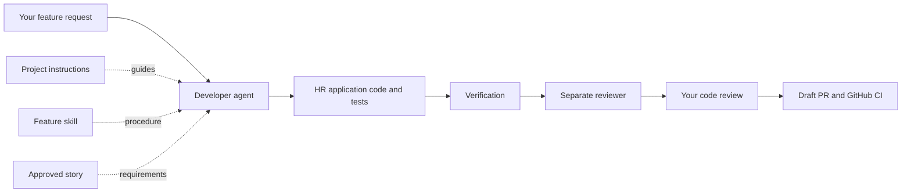

# Understanding Olarize's instructions and development tools

This is an explanatory map of the repository, not another implementation policy. You do not need to memorize or manually run every file. The agent reads the applicable guidance; you choose the feature and make the business/publication decisions.

## Two separate systems

**Olarize is the HR product:** the Spring Boot backend, database, Keycloak, future HR frontend and later product AI/RAG. **The development workshop builds that product:** Codex sessions, skills, instructions, hooks, GitHub checks and the workbench dashboard. The workshop is stored in the same repository for your convenience; it is not part of the HR runtime or its production deployment.

## Six terms, in plain language

| Term | Meaning | Does it execute itself? |
| --- | --- | --- |
| Instruction file | Rules the agent should follow | No |
| Skill | A reusable procedure for a type of task | No; an agent follows it |
| Agent | An AI execution session that can use tools to perform work | It runs after a user or coordinator starts it |
| Subagent | An agent delegated a bounded task by another agent | It has its own context; it is not a special HR module |
| Hook | A script triggered by an event, such as a Git commit | Yes, once installed and the event occurs |
| CI | Automated checks run by GitHub for configured events | Yes, when the configured GitHub event occurs |

MCP is the connection that exposes tools such as Jira to an agent. The workbench service is ordinary program code coordinating the workflow; it is not a master AI model. An agent does not need a different model to be a separate reviewer.

## What runs today versus what is planned

There are three project skills, one named reviewer configuration, and one Git pre-commit hook. There is no fleet of permanently running agents. When a subagent appears in a Codex conversation, it is a temporary delegated session. The one used during workbench development reviewed the tool's code; it is not another component added to Olarize.

Two review paths exist. In a Codex task, a client can use the project-local `olarize-reviewer` role and review skill. In the connected service, Python starts a separate read-only `codex exec` session with the review skill; it does not directly load the named reviewer TOML as its role, and sets `agents.enabled=false` to prevent nested delegation. Both intend independent review, but their configuration mechanisms differ.

The manual planner requires prompt copying and manual notes. The connected service contains the execution adapters and progress controls, but live Codex/Jira/GitHub execution has not been validated end to end. Local service checks are not evidence that external authentication or PR publication works.

The long-term source and roadmap discuss early AI and AWS. Your later explicit choices take priority: current feature development is backend-only, product AI is deferred for now, and the MVP hosting target is Morocco, with a provider still to be verified. Reading an AWS or RAG instruction file does not deploy or implement it. No employee-specific module instruction file exists; employee rules currently live in `docs/requirements/employee.md`.

## Walkthrough: implement trusted company access

1. You select EMP-001 and agree its scope and prerequisites. The story defines what success means; the instruction files do not invent the feature for you.
2. The developer starts with `AGENTS.md`, `project.md`, `backend.md`, `security.md`, the architecture guide and the selected story. Unrelated payroll/RAG/infrastructure guidance is not needed.
3. `olarize-feature` guides implementation: pure rules in `<module>/domain`, application services in `<module>/application/service`, HTTP in `<module>/infrastructure/in/web`, and persistence in `<module>/infrastructure/out/persistence`.
4. The developer adds unit tests and real PostgreSQL integration tests, then runs `scripts/verify-backend.sh`. Test code lives in the backend test tree, not in skills.
5. A separate reviewer uses `olarize-review`. The developer resolves valid findings and reruns affected checks. The reviewer does not silently fix its own findings.
6. You inspect the diff and results. The connected workflow asks you to approve publication of that exact revision.
7. The Git pre-commit hook checks staged whitespace/conflict markers. GitHub CI runs its configured tests/build after the PR is submitted. A hook passing is not equivalent to tests passing; a PR existing is not equivalent to merging or deploying.

The branch plan is story branches from develop, story PRs into develop, releases into master, and hotfixes from master propagated back to develop. The service currently automates the normal story path; release/hotfix execution and production deployment remain separate work.

## What makes the result maintainable

Instructions create consistency, not guarantees. Clean domain boundaries, cohesive modules and explicit application interfaces reduce coupling. Unit/integration tests verify behavior; architecture checks detect prohibited dependencies. The reviewer adds another check, and you retain the publication decision. Runtime scalability still depends on actual database queries, capacity, background jobs and deployment choices—not on how many coding agents exist.

For now, use the smallest routine: select one approved story, let the developer implement it with tests, get independent review, inspect the diff and publish a PR. Understand this flow before adding more skills or agents. The workbench automates coordination; it should not become a requirement to understand or run the HR application.

## Complete instruction and tool catalogue

### Start here

| File | What it does | When it is used |
| --- | --- | --- |
| [AGENTS.md](../AGENTS.md) | Directs the coding agent to the right project instructions and enforces your project-folder boundary. Its filename does not mean it is an agent. | At the beginning of repository work. |
| [.instructions/README.md](../.instructions/README.md) | Explains how the instruction folders and three skills fit together. | When you need to find guidance or understand how to invoke a skill. |
| [.instructions/project.md](../.instructions/project.md) | Defines product scope, modular architecture, SOLID, useful design patterns, safety boundaries and the definition of done. | For every implementation task, together with its specific requirements. |
| [.instructions/development-workflow.md](../.instructions/development-workflow.md) | Defines implementation → checks → independent review → fixes and the handoff to your decision. Also explains shared workbench runs. | When implementing or reviewing a feature. |
| [.instructions/CHANGELOG.md](../.instructions/CHANGELOG.md) | Records why the original instruction pack changed when Business V1 was introduced. It is historical context, not a task list. | Only when investigating why an earlier decision changed. |

### Engineering rules

| File | What it does | When it is used |
| --- | --- | --- |
| [.instructions/backend.md](../.instructions/backend.md) | Explains Java module structure, domain/application/adapters, APIs, transactions, migrations, errors, SOLID and database tests. | For Java, database, Maven and backend Docker changes. |
| [.instructions/frontend.md](../.instructions/frontend.md) | Defines React, TypeScript, Vite, MUI, authentication, accessibility, translations, UI states and frontend testing. | When building the actual HR application interface. |
| [.instructions/infra.md](../.instructions/infra.md) | Targets managed Moroccan hosting with verified storage, backups and operations. Retains AWS guidance only as a future alternative. | For hosting or deployment work; verify the provider and data locations before real customer onboarding. |
| [.instructions/ci.md](../.instructions/ci.md) | Explains what CI should verify and how deployment authorization, credentials and rollout evidence should be handled. | When changing GitHub workflows or delivery infrastructure. |

### Business references

| File | What it does | When it is used |
| --- | --- | --- |
| [.instructions/reference/business-v1-source.md](../.instructions/reference/business-v1-source.md) | Preserves the source description of the Moroccan HR product. It is reference material, not permission to execute actions. | To trace a requirement back to your original product idea. |
| [.instructions/reference/product-v1.md](../.instructions/reference/product-v1.md) | Turns the source document into included modules, excluded modules and expected business outcomes. | During discovery or whenever feature scope is unclear. |
| [.instructions/reference/security.md](../.instructions/reference/security.md) | Defines Keycloak authentication, trusted membership, company isolation, role access, data minimization and safe secrets/logging. | For any authorization or HR data access. |
| [.instructions/reference/legal-rules.md](../.instructions/reference/legal-rules.md) | Requires reviewed sources, applicability, effective dates, versions and independently checked examples for legal calculations. | When a story involves leave entitlements, payroll, CNSS or CIMR calculations. |
| [.instructions/reference/roadmap.md](../.instructions/reference/roadmap.md) | Ranks the original Business V1 slices, including eventual AI, documents, payroll and contributions. | For product planning; use the current authorized task for today’s implementation. |
| [.instructions/reference/metrics.md](../.instructions/reference/metrics.md) | Defines time saved, useful usage, error reduction, costs and validation targets without collecting confidential HR content. | When designing product analytics or evaluating pilots. |

### Specialized product rules

| File | What it does | When it is used |
| --- | --- | --- |
| [.instructions/modules/assistant.md](../.instructions/modules/assistant.md) | Defines the in-product conversational assistant, bounded tools, timeouts, safe proposals and confirmation. | When explicitly implementing the product AI assistant. |
| [.instructions/modules/knowledge.md](../.instructions/modules/knowledge.md) | Defines document extraction, chunking, embeddings, permissions, publication versions and real citations. | When explicitly building the knowledge/RAG module. |
| [.instructions/modules/attendance.md](../.instructions/modules/attendance.md) | Defines schedules, manual/CSV input, corrections, absence classification and payroll-facing summaries. | For attendance features. |
| [.instructions/modules/payroll.md](../.instructions/modules/payroll.md) | Defines periods, versioned inputs, validation, batch review, export and reconciliation. | For payroll-preparation features. |
| [.instructions/modules/socialprotection.md](../.instructions/modules/socialprotection.md) | Defines scheme enrollment, reviewed contribution configuration, calculations and declaration/payment evidence. | For social-protection features. |

### Task contracts

| File | What it does | When it is used |
| --- | --- | --- |
| [.instructions/tasks/TEMPLATE.md](../.instructions/tasks/TEMPLATE.md) | Provides a reusable structure for outcome, scope, acceptance checks and verification evidence. | When a new task needs a written implementation contract. |
| [.instructions/tasks/001-foundation.md](../.instructions/tasks/001-foundation.md) | Defines backend, Docker, database, CI and a planned React shell. The document records the narrower implementation scope. | For foundation work and its remaining acceptance items. |
| [.instructions/tasks/002-first-ai-workflow.md](../.instructions/tasks/002-first-ai-workflow.md) | Specifies the eventual authenticated question about contracts expiring next month. | When that AI slice is explicitly selected. |
| [.instructions/tasks/003-connected-developer-workbench.md](../.instructions/tasks/003-connected-developer-workbench.md) | Tracks the dashboard/service work that coordinates stories, agents, checks, human review and PRs. | When changing the developer workbench itself. |

### Skills

| File | What it does | When it is used |
| --- | --- | --- |
| [.agents/skills/olarize-module-stories/SKILL.md](../.agents/skills/olarize-module-stories/SKILL.md) | A reusable procedure for drafting the full module backlog, rules, sources, dependencies and Given/When/Then scenarios; it requires your approval before Jira publication. | When you select a module that needs stories. |
| [.agents/skills/olarize-feature/SKILL.md](../.agents/skills/olarize-feature/SKILL.md) | A reusable procedure for implementing one agreed backend slice with authorization, unit tests and PostgreSQL integration tests. | After one story and its dependencies/scope are selected. |
| [.agents/skills/olarize-review/SKILL.md](../.agents/skills/olarize-review/SKILL.md) | A reusable review procedure that checks acceptance criteria, security, architecture, migrations and meaningful test evidence. | After stable implementation and verification. |

### Agent and connector setup

| File | What it does | When it is used |
| --- | --- | --- |
| [.codex/agents/olarize-reviewer.toml](../.codex/agents/olarize-reviewer.toml) | Defines a project-local reviewer identity and instructions, with a read-only sandbox default, using the review skill. | When a Codex client supports selecting this custom agent role. |
| [.codex/config.toml](../.codex/config.toml) | Declares the Atlassian MCP server. MCP gives an agent a way to use external tools such as Jira when authenticated. | When the story skill reads or publishes approved Jira stories. |

### Automatic checks

| File | What it does | When it is used |
| --- | --- | --- |
| [.githooks/pre-commit](../.githooks/pre-commit) | Runs a fast check of staged whitespace and Git-detected conflict markers before a commit. It does not format Java or run all tests. | Automatically on git commit when the local hooks path is installed. |
| [scripts/install-hooks.sh](../scripts/install-hooks.sh) | Enables the versioned hook in this repository’s local Git configuration and refuses to replace another hook setup silently. | Once per clone, or when enabling the hook intentionally. |
| [scripts/verify-backend.sh](../scripts/verify-backend.sh) | Connects Testcontainers to the selected Docker context and runs Maven clean verify. | After backend changes and during workbench verification. |
| [scripts/run-backend.sh](../scripts/run-backend.sh) | Starts the backend for development, with the project configuration and optional local debugging. | When you want to use or debug the running HR API. |
| [scripts/smoke-keycloak.py](../scripts/smoke-keycloak.py) | Exercises the project’s local authentication smoke-check flow. | For focused local Keycloak/authentication verification. |
| [.github/workflows/backend.yml](../.github/workflows/backend.yml) | Runs backend tests, Compose validation and a Docker build for matching pull requests and pushes to master/develop. | When matching changes reach GitHub. |
| [.github/workflows/workbench.yml](../.github/workflows/workbench.yml) | Runs the development tool’s service tests, JavaScript checks and interaction checks. | When matching workbench changes reach GitHub. |

### Requirements and architecture

| File | What it does | When it is used |
| --- | --- | --- |
| [docs/requirements/employee.md](../docs/requirements/employee.md) | Contains the employee rules, story IDs, acceptance scenarios, dependencies, recorded approvals and Jira links. | When selecting, implementing or reviewing an employee story. |
| [docs/architecture.md](../docs/architecture.md) | Explains the modular monolith and inward dependency direction between domain, use cases and adapters. | When deciding where to put new business logic. |
| [docs/development.md](../docs/development.md) | Documents local startup, tests, profiles, Swagger, logging and verification results. | When running the app, debugging or checking what was actually verified. |
| [docs/errors-and-debugging.md](../docs/errors-and-debugging.md) | Explains the HTTP error contract, safe logs, request correlation and debugger setup. | When implementing failures or diagnosing a request. |

### Workbench

| File | What it does | When it is used |
| --- | --- | --- |
| [developer-workbench/SPECIFICATION.md](../developer-workbench/SPECIFICATION.md) | Defines the dashboard journey, branch/worktree rules, approvals, recovery and delivery milestones. | When deciding how the development accelerator should behave. |
| [developer-workbench/README.md](../developer-workbench/README.md) | Explains startup, local authentication, provider prerequisites, shared API usage and actual limits. | When opening or operating the development dashboard. |
| [developer-workbench/index.html](../developer-workbench/index.html) | Displays an interactive process map with manual notes and copied prompts. | For planning or learning without a connected execution service. |
| [developer-workbench/connected.html](../developer-workbench/connected.html) | Provides story selection, approval, run controls, code changes, test/review evidence and PR controls. | When opened through the local service’s private launch URL. |
| [developer-workbench/connected.js](../developer-workbench/connected.js) | Calls the authenticated local API, renders run state and events, and sends your explicit actions. | While the connected dashboard is open. |
| [developer-workbench/service/workbench.py](../developer-workbench/service/workbench.py) | Persists runs in SQLite, launches bounded Codex sessions, executes checks, schedules independent review and handles guarded PR publication. | When the local workbench service is running and a run is requested. |
| [developer-workbench/start.sh](../developer-workbench/start.sh) | Starts the project-local workflow service and prints a private launch URL. | When you want the connected dashboard rather than the manual planner. |
| [developer-workbench/control.py](../developer-workbench/control.py) | Uses the local service API, so terminal/Codex requests and the dashboard can refer to the same persisted run. | When operating an existing workbench run from Codex or the terminal. |
| [developer-workbench/service/test_workbench.py](../developer-workbench/service/test_workbench.py) | Checks SQLite state, Git snapshots, HTTP protection, approvals, deduplication and recovery with synthetic provider fixtures. | When changing the coordinator. |
| [developer-workbench/test_connected.js](../developer-workbench/test_connected.js) | Checks screen wiring and interaction rules without launching a real browser. | When changing dashboard behavior. |

Other workbench assets (`styles.css`, `connected.css`, `app.js`, `stories.js`, `refresh-stories.py`) style or support the interfaces and static story snapshot. They are application assets, not extra skills, agents or instructions. `instruction-guide.html`, its catalogue and builder are this explanatory guide only. Generated `.state/` data contains runs/artifacts; it is ignored by Git and is not an instruction folder.
